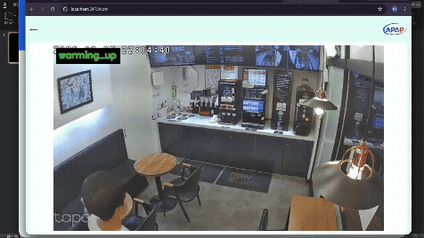
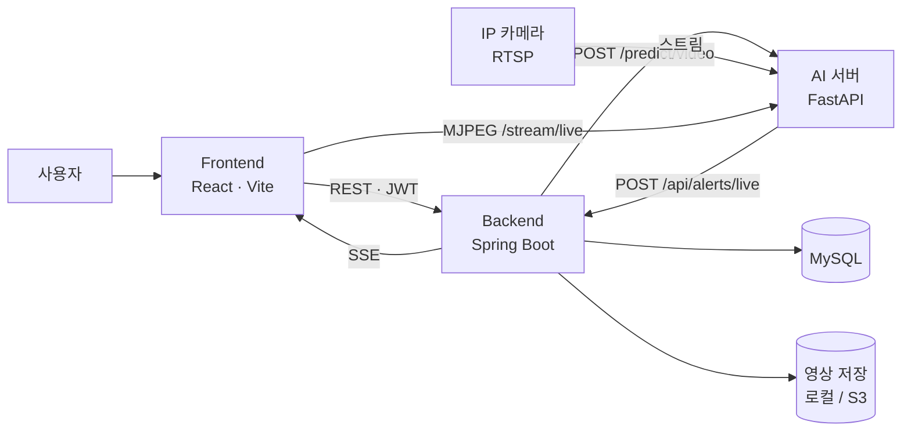
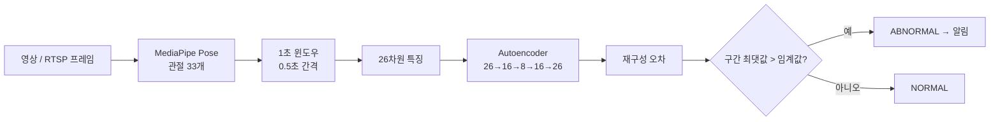

# APAP — Abnormal Pattern Alarmer Platform

정상 행동만 학습해서, 사전에 정의하지 않은 이상행동까지 탐지하고 알림을 보내는 AI 영상 분석 서비스

> 한이음 드림업 ICT 멘토링 프로젝트 · 4인 팀(프론트엔드 1, 백엔드 1, AI 2) · 2026.04 ~ 2026.10

## 한눈에 보기

- **정상 영상만으로 학습**하는 Autoencoder 이상 탐지 — 이상행동 라벨링이 필요 없습니다.
- **업로드 영상과 IP 카메라(RTSP) 실시간 스트림**을 같은 판정 함수로 처리하고, 두 경로의 오차값이 일치함을 검증했습니다.
- 모델 → FastAPI 서빙 → Spring Boot 백엔드 → React 대시보드까지 **end-to-end 서비스**로 연결했습니다.
- 개선 과정을 **원인 진단 → 해결 → 수치 검증** 순서로 기록했습니다 ([문제 해결 기록](docs/troubleshooting.md)).

## 구성과 작업 위치

| 영역 | 위치 | 주요 내용 |
|---|---|---|
| 프론트엔드 | `frontend/` | 관리자 대시보드, 실시간 CCTV 화면, 알림 토스트 |
| 백엔드 | `backend/` | API 서버, 인증·권한, 영상 관리, 분석 작업·알림 이벤트 관리(SSE) |
| AI | `ai-server/` | 이상행동 탐지 모델 학습, 추론 서버, RTSP 실시간 분석 |
| 문서 | `docs/` | 아키텍처, API 명세, 회의록, 보고서 |
| 데이터 | `data/` | 데이터셋 설명 및 관리 방식 기록 |

## 시연

[시연 영상 보기](https://youtu.be/zcmWUhsjFHQ?si=jRpD8kogbX32h6yF)


## 문제 정의와 접근

**기존 CCTV 관제의 한계**
- 사람이 화면을 계속 지켜봐야 합니다.
- 지능형 CCTV도 넘어짐·침입처럼 **미리 정의한 행동만** 탐지합니다.
- 이상행동은 종류가 다양하고, 실제 영상은 수집하기 어렵고 개인정보 문제가 있습니다.

**접근**: 이상행동을 학습하지 않고 **정상 행동의 패턴만 학습**한 뒤, 그 범주에서 벗어나는 행동을 이상으로 판단합니다. 장소마다 정상 행동의 기준이 다르므로, 사용자가 자기 환경의 정상 영상을 올려 학습하는 구조를 전제로 설계했습니다.

## 주요 기능

- **영상 업로드 분석**: 업로드한 영상을 비동기로 분석해 정상/비정상, 재구성 오차를 이벤트로 저장합니다.
- **실시간 CCTV 분석**: IP 카메라의 RTSP 스트림을 받아 윈도우 단위로 판정하고, 화면에 NORMAL/ABNORMAL을 오버레이합니다. 스트림이 끊기면 자동으로 재연결합니다.
- **알림**: 실시간 감지가 발생하면 알림 내역에 저장하고, SSE로 화면 우상단에 토스트를 띄웁니다.
- **인증·권한**: Google 로그인(OIDC), JWT, ADMIN/MANAGER/VIEWER 권한 구분
- **영상 관리**: 목록·재생, 리셋(화면에서만 숨김), 로컬/S3 저장 지원

## 시스템 구조



## AI 파이프라인



**특징 벡터 (26차원)**: 좌표 통계 8 + 관절 간 거리 10(5쌍 × 평균·표준편차) + 관절 각도 8(4개 관절 × 평균·표준편차)

**Autoencoder**: 입력 26 → 16 → 8 → 16 → 26 구조를 PyTorch로 구현해 정상 영상만으로 학습했습니다. 정상 패턴은 잘 복원되고 낯선 행동은 복원 오차가 크게 나오는 원리를 이용합니다.

**판정**
- 영상을 1초 길이, 0.5초 간격 구간으로 나눠 구간마다 재구성 오차를 계산합니다.
- 구간 오차의 **최댓값**이 임계값을 넘으면 비정상입니다. 영상 전체를 평균 내면 짧은 이상행동이 묻히기 때문입니다.
- 임계값은 정상 학습 샘플 오차의 **평균 + 3σ**입니다.

**학습 데이터 처리**: 추출한 관절 좌표를 캐싱해 재추출을 막고, 좌우 반전과 가우시안 노이즈로 랜드마크 레벨 증강을 적용합니다(정상 샘플 102개 → 306개).

## 개발 중 해결한 주요 문제

- **짧은 이상행동 미탐** → 1초 윈도우 분할과 구간 최댓값 판정으로 해결
- **임계값 불안정** → 데이터 증강, seed 고정, 3-seed 교차검증으로 재현성 확보
- **촬영 조건으로 인한 오탐** → 단독 인물·고정 카메라 기준으로 학습 영상 선별

원인 진단 과정과 수치는 [docs/troubleshooting.md](docs/troubleshooting.md)에 정리했습니다.

## 한계와 향후 과제

- 정확도·재현율 같은 **정량 평가는 수행하지 못했습니다.** 확인한 것은 소수의 테스트 영상에서 정상·비정상이 맞게 판정된다는 점까지입니다.
- 정상 학습 영상이 적어서, 학습하지 않은 전환 동작(정지·방향 전환)은 정상이어도 오탐이 날 수 있습니다. 증강은 기존 동작의 변형만 만들 수 있어 근본 해결에는 원본 데이터 확충이 필요합니다.
- 한 명 기준으로 동작합니다. 여러 명을 각자 판정하려면 사람 검출과 추적 단계가 필요합니다.
- 1초 구간의 통계를 보는 구조라서 프레임 순서(시간 흐름) 자체를 학습하지는 않습니다. 시계열 모델 적용은 향후 과제입니다.
- 카메라 각도·거리에 민감해서 환경마다 정상 영상으로 다시 학습해야 합니다.

## 기술 스택

| 영역 | 사용 기술 |
|---|---|
| AI | Python 3.10, PyTorch, MediaPipe Pose, OpenCV, FastAPI |
| Backend | Java 17, Spring Boot 3.3, Spring Security(JWT, Google OIDC), JPA, MySQL 8.4 |
| Frontend | React, Vite |
| 저장소·인프라 | Docker(MySQL), AWS S3(영상 저장, 로컬 모드 선택 가능) |

## 로컬 실행 방법

**준비**: Python 3.10, Java 17, Node.js, Docker

**1. MySQL**
```bash
docker compose up -d
```

**2. 백엔드 (8080)**
```bash
cd backend
GOOGLE_CLIENT_ID=<클라이언트 ID> DB_PASSWORD=<DB 비밀번호> ./mvnw spring-boot:run
```

**3. AI 서버 (8000)**
```bash
cd ai-server/APAP_aimodel
python3.10 -m venv venv && source venv/bin/activate
pip install -r requirements.txt

# 학습: data/raw/normal/ 에 정상 영상을 넣고 실행 (checkpoints/ 에 모델 생성)
PYTHONPATH=src python3 -m src.anomaly.train

# 서버 실행
BACKEND_URL='http://localhost:8080' \
RTSP_URL='rtsp://<계정>:<비밀번호>@<카메라 IP>:554/stream2' \
PYTHONPATH=src python3 -m uvicorn src.api.main:app --host 0.0.0.0 --port 8000
```

- `RTSP_URL`이 없으면 `/stream/live`가 503을 반환합니다.
- `BACKEND_URL`이 없으면 알림이 백엔드로 전달되지 않습니다.
- 알림을 남기려면 백엔드에 `CCTV` 타입 영상 소스가 등록되어 있어야 합니다.
- 비밀번호에 `!` 같은 특수문자가 있으면 셸이 해석하지 않도록 작은따옴표로 감쌉니다.

**4. 프론트엔드 (5173)**
```bash
cd frontend
npm install
npm run dev
```

## 폴더 구조

```text
.
├─ frontend/                  # 관리자 대시보드, 화면
├─ backend/                   # API 서버, DB 연동, 알림 이벤트 관리
├─ ai-server/APAP_aimodel/
│  ├─ src/
│  │  ├─ anomaly/             # train.py, infer.py, realtime.py
│  │  ├─ api/main.py          # FastAPI (/predict/video, /stream/live)
│  │  ├─ features.py          # 26차원 특징 벡터
│  │  ├─ windowing.py         # 1초 윈도우 분할
│  │  ├─ augmentation.py      # 랜드마크 레벨 증강
│  │  ├─ feature_cache.py     # 관절 좌표 캐시
│  │  └─ extract_pose.py      # MediaPipe 관절 추출
│  └─ tests/
├─ docs/                      # 아키텍처, API 명세, 보고서, 문제 해결 기록
└─ docker-compose.yml
```

## 협업 규칙

- `dev`는 통합 브랜치입니다. 직접 push하지 않고 `feature/<역할>-<작업>` 브랜치에서 작업한 뒤 Pull Request로 merge합니다.
- PR에는 변경 내용, 기존 기능 회귀 테스트 결과, 알려진 한계를 적습니다.
- 원본 영상, 학습 데이터, 모델 파일, API Key·DB 비밀번호·JWT Secret은 GitHub에 올리지 않습니다.
